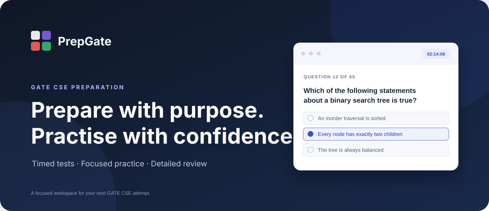

<div align="center">
  

  <p><strong>Prepare with purpose. Practise with confidence.</strong></p>
  <p>A focused GATE CSE practice platform with timed tests, subject-wise learning and exam-style question review.</p>

  <p>
    
    
    
    
    
    
  </p>

  <p><a href="#features">Features</a> · <a href="#getting-started">Getting started</a> · <a href="#content-workflow">Content workflow</a> · <a href="#project-structure">Project structure</a> · <a href="#roadmap">Roadmap</a></p>
</div>

---

## About PrepGate

**PrepGate** is a GATE Computer Science and Information Technology (CSE) preparation platform built around a familiar computer-based test experience. It brings timed mock tests, focused subject and topic practice, and post-test review into one place.

The goal is simple: make deliberate practice easier to start, easier to measure, and easier to repeat.

> PrepGate is an independent practice project. It is not affiliated with or endorsed by the GATE organising institute. Generated and demo questions are not official GATE questions. Always check question content and answers before relying on them for exam preparation.

## What you can do

| Feature | What it includes | Availability |
|---|---|---|
| Account and session | Register, log in, log out and restore your session | Available |
| Timed tests | Exam instructions, question palette, timer and navigation | Available |
| Question formats | MCQ, MSQ and NAT with GATE-style marking | Available |
| Autosave | Server-synced responses, refresh recovery and offline save queue | Available |
| Results and review | Score, answer review and explanations after submission | Available |
| Attempt history | Revisit completed and active attempts | Available |
| Subject and topic practice | Focused tests and private practice from the published bank | Available, depending on bank content |
| Admin question bank | Create, edit, review, verify, publish and manage questions | Admin only |
| AI question drafts | Generate original question drafts with Gemini for human review | Optional; requires API key and quota |
| Student analytics dashboard | Charts and sample performance summaries | **Prototype data — not real analytics yet** |
| Leaderboard | Competitive student rankings | Not implemented |

The available tests depend on the questions that have been added, reviewed and published. The repository currently includes development/demo content; it does not ship with a complete official GATE question bank.

## Getting started

### Requirements

- Node.js 20 or newer
- npm 10 or newer
- MongoDB Atlas or a local MongoDB instance
- Git

### 1. Get the code

```bash
git clone <your-repository-url>
cd <repository-folder>
```

### 2. Install dependencies

From the repository root:

```bash
npm run install:all
```

Or install each app separately:

```bash
cd server && npm install
cd ../client && npm install
```

### 3. Configure the backend

Create your server environment file:

```bash
cp server/.env.example server/.env
```

On Windows PowerShell:

```powershell
Copy-Item server/.env.example server/.env
```

Open `server/.env` and set at least:

```env
MONGODB_URI=mongodb+srv://<username>:<password>@<cluster>/<database>
JWT_SECRET=<at-least-32-random-characters>
CLIENT_ORIGIN=http://localhost:5173
```

Generate a secure JWT secret with:

```bash
node -e "console.log(require('crypto').randomBytes(48).toString('hex'))"
```

To create the first administrator, also set `ADMIN_EMAIL`, `ADMIN_PASSWORD` and optionally `ADMIN_NAME` before running the seed. Never commit `.env` or share credentials publicly.

Gemini is optional. To enable AI draft generation, add `GEMINI_API_KEY` to `server/.env`. Without it, the rest of the platform can still run; AI generation will remain unavailable.

### 4. Initialise the database

From the repository root:

```bash
cd server
npm run seed
```

This creates the subject/topic taxonomy and, if the admin variables are configured, the first admin account. The seed is designed to be safe to re-run.

For local development content, run:

```bash
npm run seed:demo
```

This adds the bundled demo questions and practice tests. They are original sample content, not authentic GATE previous-year questions. The demo seed is additive and idempotent; it does not delete existing users, attempts, questions or tests.

### 5. Start the app

Run the backend and frontend in separate terminals.

**Terminal 1 — API**

```bash
cd server
npm run dev
```

The API runs at `http://localhost:5000` by default.

**Terminal 2 — web app**

```bash
cd client
npm run dev
```

Open **http://localhost:5173**.

The application header/footer API indicator reports whether the backend and database are reachable.

## Content workflow

PrepGate separates question creation from publication. Questions created by an administrator or generated with AI should be reviewed before students can see them.

1. Add questions through the admin question bank, JSON import or Gemini generator.
2. Check the question statement, options, correct answer, marking, topic and explanation.
3. Verify the question in the admin workflow.
4. Publish verified questions.
5. Build tests from the published question bank.

AI-generated content is a draft, not a trusted answer key. Review every question manually before publication. The automated checks can catch structural problems and some answer inconsistencies, but they cannot guarantee academic correctness.

### Content commands

Run these from `server/`:

| Command | Purpose |
|---|---|
| `npm run seed` | Create base subjects/topics and the initial admin |
| `npm run seed:demo -- --dry-run` | Preview the demo seed without writing |
| `npm run seed:demo` | Add bundled demo questions and tests |
| `npm run seed:samples` | Add workflow sample questions as reviewable drafts |
| `npm run content:expand` | Request original ADVANCED question drafts using Gemini |
| `npm run generate:bank -- --per-topic 5 --style ADVANCED --difficulty hard --max-total 300` | Run the generator with explicit limits |
| `npm run tests:build -- --dry-run` | Preview test creation without database writes |
| `npm run tests:build` | Build tests from eligible published questions |

The generator requires `GEMINI_API_KEY`, an administrator and available API quota. Generated questions remain drafts until reviewed and published. Test building will report when the bank does not contain enough eligible questions; it should not be treated as proof that a full test series exists.

## Tech stack

| Layer | Technologies |
|---|---|
| Frontend | React 18, Vite 6, React Router, Tailwind CSS v4, Zustand, Recharts |
| Backend | Node.js 20+, Express 4, Zod |
| Database | MongoDB Atlas, Mongoose 8 |
| Authentication | bcrypt password hashing, JWT in HttpOnly cookie |
| AI content workflow | Gemini API (optional), validation and admin review |
| Mathematical rendering | KaTeX |

## Project structure

```text
.
├── assets/                 # README artwork
├── client/                 # React + Vite application
│   └── src/
│       ├── api/             # API clients
│       ├── components/      # Shared UI and common components
│       ├── features/        # Exam, dashboard and landing components
│       ├── layouts/         # Public, auth, dashboard and exam layouts
│       ├── pages/           # Route-level pages
│       ├── prototype/       # Sample dashboard data (not real analytics)
│       ├── routes/          # Router and route guards
│       └── store/           # Client state
└── server/                 # Express API
    └── src/
        ├── config/          # Environment and database configuration
        ├── jobs/            # Background attempt expiry sweeper
        ├── middleware/      # Auth, validation, CSRF and rate limits
        ├── models/          # Mongoose models
        ├── modules/         # Auth, tests, attempts, questions and admin APIs
        ├── seed/             # Taxonomy, demo content, AI and test builders
        └── utils/            # Shared server utilities
```

## Useful scripts

From the repository root:

| Command | Purpose |
|---|---|
| `npm run dev:server` | Start the API in watch mode |
| `npm run dev:client` | Start the Vite development server |
| `npm run build:client` | Build the frontend for production |
| `npm run test:server` | Run backend unit tests |

Inside `client/`:

```bash
npm run build
npm run preview
```

Inside `server/`:

```bash
npm test
npm start
```

**Database integration tests are destructive to their configured test database.** They require `TEST_MONGODB_URI` to point to a separate disposable database whose name contains `test`. The test suite wipes that database before and after running. Never point `TEST_MONGODB_URI` at your main development or production database. See [`server/README.md`](server/README.md) for details.

## Deployment notes

- Deploy the frontend and backend separately (Vercel for the client, Render for the API).
- The browser only talks to the Vercel origin. `vercel.json` rewrites `/api/v1/*` to the Render API, so the HttpOnly login cookie is a first-party cookie on the Vercel domain. See [`DEPLOYMENT.md`](DEPLOYMENT.md) for the exact Vercel and Render settings.
- **Do not set `VITE_API_BASE_URL` on Vercel.** The client no longer reads it. Delete it if it exists.
- Set `CLIENT_ORIGIN` on the backend to the exact deployed frontend origin (no trailing slash).
- Use HTTPS for both services so the production authentication cookie can be sent securely.
- Configure MongoDB Atlas network access for the backend host.
- Set a strong `JWT_SECRET`; never expose MongoDB credentials, Gemini keys or admin credentials in frontend variables.
- Run a production build and verify sign-up, login, timed attempts, autosave, submission and result review before announcing a public launch.

## Roadmap

- [x] Core CBT exam flow and server-side evaluation
- [x] Authentication, attempt history and admin content workflow
- [x] Demo content and optional AI draft generation
- [ ] Replace prototype dashboard statistics with real analytics
- [ ] Expand and quality-review the question bank and test series
- [ ] Complete production hardening, accessibility and deployment checks
- [ ] Add further student learning and performance tools

## Contributing

Contributions, bug reports and suggestions are welcome. Before opening a pull request:

1. Keep changes focused and describe the problem they solve.
2. Run the relevant backend tests and frontend production build.
3. Never include `.env` files, API keys, database credentials or personal data.
4. Include screenshots for visible UI changes where practical.

## License

No license file is currently included in this repository. Unless a license is added, the code should not be assumed to be available for unrestricted reuse.

---

<div align="center">
  <strong>PrepGate</strong><br />
  <sub>Prepare with purpose. Practise with confidence.</sub>
</div>
